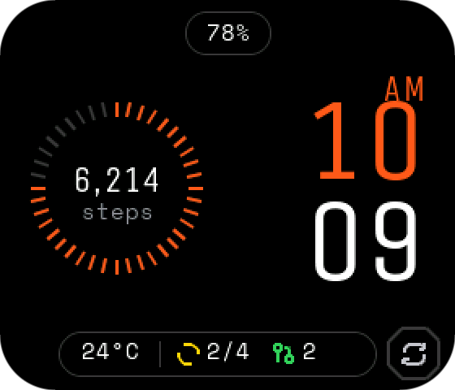
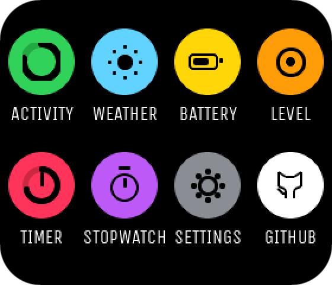
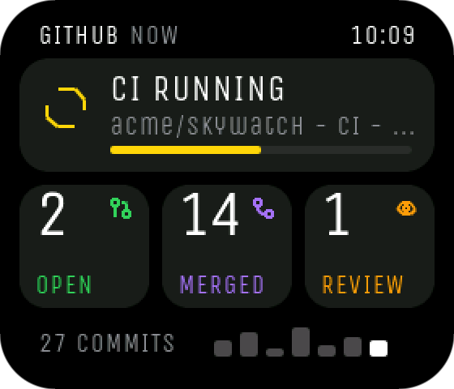
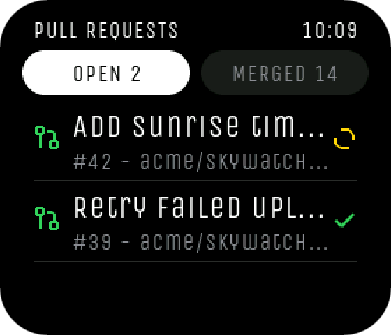
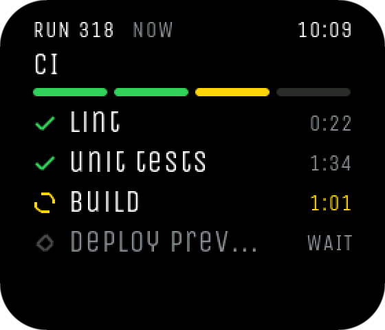
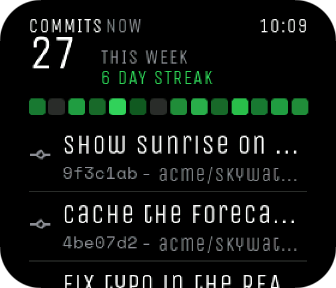
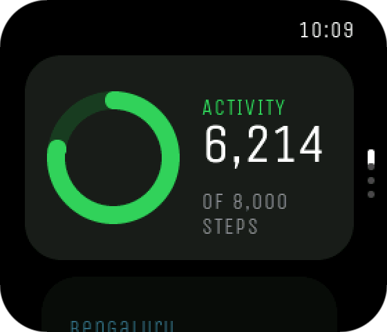
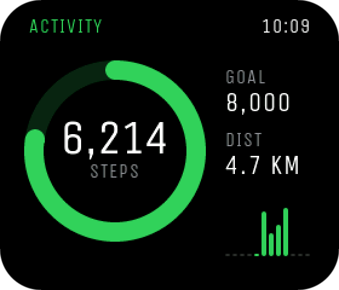
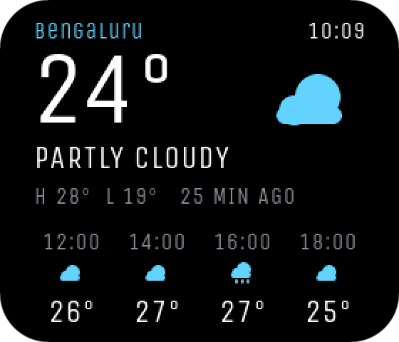
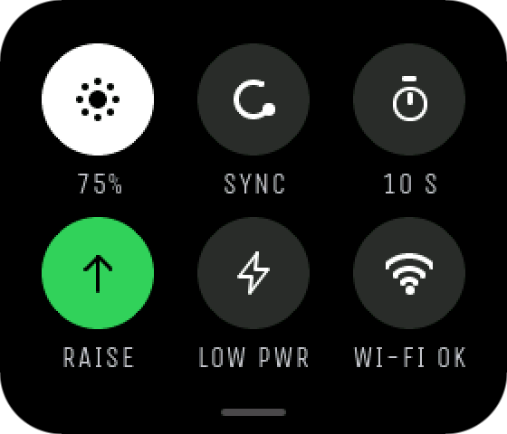

<div align="center">

# HoroDyne

**watchOS-style firmware that turns the Waveshare ESP32-S3-Touch-LCD-1.69 into a wristwatch, with your GitHub pull requests and CI runs on the clock face.**

[](https://github.com/adityaRajGit/HoroDyne/releases/latest)
[](LICENSE)
[](https://docs.waveshare.com/ESP32-S3-Touch-LCD-1.69)
[](https://lvgl.io)



</div>

## Features

- **Clock face:** the time with a steps dial, battery, weather, your latest CI run and your open PR count. Tap any of these to open its app.
- **Eight apps:** Activity, Weather, Battery, Level, Timer, Stopwatch, GitHub and Settings.
- **Smart Stack and Control Center:** swipe up for glanceable cards, or swipe down for brightness, sync, screen timeout, raise to wake, Low Power Mode and Wi-Fi.
- **GitHub on your wrist:** open and merged PRs with checks, diff size and reviews, Actions runs with job-by-job progress, and recent commits with a 14-day activity strip and your streak.
- **Built around sleep:** the screen turns off and the chip drops into light sleep. Raising your wrist, tapping or pressing PWR wakes it. Wi-Fi only comes on for a sync every 6 hours and for GitHub refreshes.
- **No phone app or account:** you set it up from a Wi-Fi page. Time comes from NTP, and weather comes from Open-Meteo, which needs no API key.
- **3D-printable case:** OpenSCAD source and ready-to-print STLs.

<table>
  <tr>
    <td></td>
    <td></td>
    <td></td>
  </tr>
  <tr>
    <td></td>
    <td></td>
    <td></td>
  </tr>
  <tr>
    <td></td>
    <td></td>
    <td></td>
  </tr>
</table>

<sub>Rendered from the firmware's own UI code on a PC, using sample data.</sub>

> [!NOTE]
> HoroDyne is an early hobby project. Step counting in particular isn't reliable yet, so read [Known issues](#known-issues) before you rely on it.

## Hardware

| Part | Notes |
|---|---|
| [Waveshare ESP32-S3-Touch-LCD-1.69](https://docs.waveshare.com/ESP32-S3-Touch-LCD-1.69) | ESP32-S3 with 16 MB flash and 8 MB PSRAM, ST7789V2 LCD used in landscape (280 × 240), CST816T touch, QMI8658 motion sensor, PCF85063 clock chip |
| Single-cell LiPo | Optional: the watch also runs from USB. Developed with a PL432224 cell, treated as 400 mAh (label: 3.87 V, 1.08 Wh, which works out to about 280 mAh). Check the plug fits the board's socket and that red goes to `+`, because generic cells often have a different plug or reversed polarity. |
| Case and 20 mm strap | Optional. See [Case](#case). |

> [!WARNING]
> **Don't connect a small cell and then plug in USB.** Schematic V2.1 and the ETA6098 datasheet show R25 (82 kΩ) setting the charge current to about 2 A. This hasn't been measured, and the current you actually get also depends on the USB source. Charging starts as soon as USB power is present, and neither firmware nor powering off the watch can limit or stop it, because the charger sits ahead of the power switch. The board also has no battery temperature sensor.
>
> Check the maximum charge current on your cell's datasheet. A 2 A charge is about 5C for a 400 mAh cell and about 7C for a 280 mAh cell, well beyond what small cells are normally rated for. If your cell can't take it, remove it from the board and charge it with a suitable single-cell LiPo charger.

## Install a release

1. Download `horodyne-<version>-full.bin` from the [latest release](https://github.com/adityaRajGit/HoroDyne/releases/latest).
2. Connect the board over USB and flash it at address `0x0`, using either of these:
   - **In Chrome or Edge:** open the [esptool web flasher](https://espressif.github.io/esptool-js/), connect, set the flash address to `0x0`, choose the file and program it.
   - **From a terminal:**
     ```sh
     pip install esptool
     python -m esptool --chip esp32s3 -p COM3 -b 921600 write-flash 0x0 horodyne-<version>-full.bin
     ```
     Replace `COM3` with your port, such as `/dev/ttyACM0` on Linux.

If the port refuses the connection, hold BOOT, tap RESET, release BOOT and try again.

The full image erases your saved settings. To upgrade and keep them, flash `horodyne-<version>-app.bin` at `0x10000` instead.

## First boot

The watch starts with `--:--` and **SET UP WI-FI**.

1. On the watch, open Settings > Wi-Fi Setup, or swipe down on the face and tap Wi-Fi.
2. On your phone, join the network `HORODYNE-SETUP`.
3. On the page that opens, pick your Wi-Fi and type your city. You can also add your GitHub username and token here, or read [GitHub app](#github-app) first.

Time zone and 24-hour time are in Settings. The default zone is India Standard Time. Ten zones are built in, and you can add more to `TZ_LIST` in `Horodyne/svc_clock.cpp`.

## Controls

| Action | Result |
|---|---|
| Swipe up on the face | Smart Stack |
| Swipe down on the face | Control Center |
| Press PWR on the face | App grid |
| Swipe right | Go back |
| Press PWR in an app | Return to the face |
| Double-press PWR | Reopen the last app |
| Hold PWR for 2 seconds | Power-off screen |
| Raise your wrist, tap or press PWR | Wake the screen |

## GitHub app

The app shows your PRs, Actions runs and commits. It fetches data only when you open it or tap refresh on the face, and it doesn't poll in the background. PR and commit data stays in RAM, so a restart clears it.

1. Create a [fine-grained token](https://github.com/settings/personal-access-tokens/new) with read-only access to the repositories you want to see.
2. Save your username and token on the watch. USB is the safer way: open a serial monitor at 115200 baud and send:
   ```text
   gh <username> <token>
   ```
   The Wi-Fi setup page works too, but `HORODYNE-SETUP` is an open network and the page isn't encrypted, so someone nearby could read what you type.

The token is stored **unencrypted** in the watch's flash. Keep it read-only, and revoke it if you lose the watch. GitHub requests verify the server certificate against the roots in `Horodyne/gh_ca.h`.

## Build from source

You need [arduino-cli](https://arduino.github.io/arduino-cli/). On Windows, run these from Git Bash:

```sh
URL=https://espressif.github.io/arduino-esp32/package_esp32_index.json
arduino-cli core update-index --additional-urls $URL
arduino-cli core install esp32:esp32@3.3.12 --additional-urls $URL
arduino-cli lib install lvgl@9.6.0 LovyanGFX@1.2.32 WiFiManager@2.0.17 ArduinoJson@7.4.3 SensorLib@0.5.0

git clone https://github.com/adityaRajGit/HoroDyne.git
cd HoroDyne
sh build.sh                    # compile into build/
PORT=COM3 sh build.sh upload   # compile and flash
```

A plain clone builds as it is. The first compile takes a while because every library is compiled. `build.sh` uses two jobs so that it fits in low memory; set `JOBS=8` to go faster.

Each run raises the build number in `Horodyne/build_info.h`, so the splash screen and Settings > About show exactly which build is on the watch.

HoroDyne has only been built on Windows so far. The scripts are plain POSIX `sh`, so Linux and macOS should work, but that's untested.

<details>
<summary>Build with the Arduino IDE instead</summary>

1. Sketch > Include Library > Add .ZIP Library, and choose `horodyne_lvconf.zip`. It holds LVGL's settings.
2. Install the five libraries above with the versions shown, and ESP32 board support version 3.3.12.
3. Open `Horodyne/Horodyne.ino`, select the board **ESP32S3 Dev Module**, and set:

| Setting | Value |
|---|---|
| Flash Size | 16MB (128Mb) |
| PSRAM | OPI PSRAM |
| Partition Scheme | 16M Flash (3MB APP/9.9MB FATFS) |
| USB CDC On Boot | Enabled |

</details>

## Fonts

| Font | Used for | Licence |
|---|---|---|
| [Unica One](https://fonts.google.com/specimen/Unica+One) | Apps, and the face time in the default build | SIL OFL 1.1 |
| [Space Mono](https://fonts.google.com/specimen/Space+Mono) | Small labels on the face | SIL OFL 1.1 |
| [Valorax](https://www.fontspace.com/valorax-font-f89146) | Optional face time and steps | Personal, non-commercial use only |

Valorax can't be shared under its licence, so it isn't in this repo or in the release binaries, and those builds use Unica One on the face. To use it on your own watch, get the font from [Makna Studio](https://maknastudio.com/product/valorax/) under a licence that fits your use, then generate the two font files and rebuild:

```sh
cd Horodyne
npx lv_font_conv --font Valorax.otf --bpp 4 --format lvgl --lv-include lvgl.h --no-compress --size 64 --symbols 0123456789- -o font_vx_time.c
npx lv_font_conv --font Valorax.otf --bpp 4 --format lvgl --lv-include lvgl.h --no-compress --size 22 --symbols 0123456789,-AMP -o font_vx_num.c
```

The build uses these files automatically when they exist, and git ignores them. Don't publish a build that contains them.

## Case

`case/horodyne_case.scad` is a parametric, one-piece case for the module and a **20 × 25 × 4 mm** pouch cell, worn in landscape on a 20 mm strap with spring bars.

| File | Print |
|---|---|
| `horodyne_case-case.stl` | The case, for a two-piece strap |
| `horodyne_case-case-nato.stl` | The case, for a 1.5 mm NATO strap |
| `horodyne_case-plate_pushers.stl` | Button caps: three, plus a spare |

Print it back-down; it needs no supports. Fit the button caps from the inside, push them fully out, then drop the module in from the front. There are no screws, so hold the module with small dots of B-7000 or E6000, or thin foam tape on the ledges.

> [!WARNING]
> A cell this small is exactly the kind the [charge warning](#hardware) is about. Don't charge it through the board's USB port without checking its charge rating first.

## Project layout

```text
Horodyne/           The firmware sketch
  hal_*             Hardware: display and touch, motion sensor, battery, power
  svc_*             Services: clock, Wi-Fi and weather, activity, GitHub, settings, timers
  ui*.cpp           LVGL screens
  config.h          Pins, tuning constants, defaults and colours
horodyne_lvconf/    LVGL settings packaged as a library (horodyne_lvconf.zip is the same thing)
case/               OpenSCAD source and STLs
test/               PC tests
docs/               Design spec and README images
build.sh            Compile and flash
```

The UI reads services and never touches hardware directly. The design spec is in [`docs/superpowers/specs/`](docs/superpowers/specs/2026-10-10-horodyne-watch-ui-design.md); it's a historical record, so this README wins where they differ.

## Tests

The battery, step-counting, timer and GitHub parsing logic run on a PC with no hardware:

```sh
sh test/run_tests.sh
```

This needs `g++` with C++17 and ArduinoJson. If ArduinoJson isn't in `~/Arduino/libraries`, set `ARDUINOJSON` to its `src` folder.

## Debugging

Serial runs at 115200 baud. Boot lines start with `horodyne:`, `imu:`, `rtc:` and `net:`, and the battery is logged every 10 seconds. Light sleep disconnects USB serial on a phone charger; on a computer the watch stays reachable. Set `DEBUG_NO_SLEEP 1` in `config.h` to keep it awake everywhere.

| Command | What it does |
|---|---|
| `b` | Prints the on-battery voltage log: a reading every 10 minutes, for about 24 hours |
| `s` | Prints step counter statistics |
| `ghsync` | Fetches GitHub data now |
| `gh <username> <token>` | Saves your GitHub login |

<details>
<summary>Bring-up checks for a new board</summary>

| Check | How | If it's wrong |
|---|---|---|
| Clock chip | The boot log prints `rtc: ticking`. | Nothing to change: the watch falls back to Wi-Fi time. |
| Touch direction | Tap the steps dial. It should open Activity. | Set `TOUCH_FLIP_X` or `TOUCH_FLIP_Y` in `hal_display.cpp`. |
| Screen position | All four corners of the face are visible. | Adjust `offset_y` in `hal_display.cpp`. |
| Raise-to-wake axis | Open Level, lay the watch flat and read the log. | Set `IMU_FACE_AXIS` and `IMU_FACE_SIGN` in `config.h`. |
| Raise-to-wake line | With `DEBUG_NO_SLEEP 0`, let the screen sleep, then lift the watch. | If it never wakes, change `IMU_WAKE_PIN` in `hal_imu.cpp`. |
| Level direction | Tilt the right edge down. The bubble should move left. | Set `LEVEL_SWAP_XY`, `LEVEL_INV_X` and `LEVEL_INV_Y` in `config.h`. |
| Step sensor | The boot log prints `imu: accel ok, step fifo ok, motion wake ok`. | Tune the `STEP_*` values in `config.h`. |
| Battery voltage | Compare Battery > volts with a multimeter on the cell. | Adjust `BAT_LOAD_COMP_V` or `BAT_DIVIDER` in `config.h`. |
| Clock drift | After a sync, the log prints `clock: drift +N s`. | With no working clock chip, shorten `SYNC_EVERY_MS`. |

</details>

## Known issues

- **Step counting isn't reliable.** Counts have been missing on the development watch and the root cause hasn't been found. The motion sensor's built-in pedometer never counted on this board either, so steps are detected in software.
- **Battery percentage is an estimate.** The charger's status pin isn't connected, so charging is inferred from voltage, and the discharge curve was tuned on one cell. Yours may read differently.
- **Battery life hasn't been measured.**
- **The clock chip doesn't tick on one of the development boards.** The firmware falls back to NTP and needs Wi-Fi for the correct time after a restart.
- **Weather requests don't verify TLS certificates.** The worst a spoofed server could do is show the wrong weather. No token is sent with those requests.

## Contributing

Issues and pull requests are welcome. `main` is protected, so every change goes through a pull request that the maintainer reviews and merges. Before you open one:

- Run `sh test/run_tests.sh`.
- Keep hardware access in `hal_*`, so the UI stays testable.
- Say which board revision you tested on, if you flashed it.
- Leave `Horodyne/build_info.h` and any Valorax font files out of your commit.

## Licence

HoroDyne's code and case files are released under the [MIT License](LICENSE). The third-party components keep their own licences:

| Component | Licence |
|---|---|
| [LVGL](https://github.com/lvgl/lvgl) | MIT |
| [LovyanGFX](https://github.com/lovyan03/LovyanGFX) | FreeBSD, with BSD and MIT parts |
| [WiFiManager](https://github.com/tzapu/WiFiManager) | MIT |
| [ArduinoJson](https://github.com/bblanchon/ArduinoJson) | MIT |
| [SensorLib](https://github.com/lewisxhe/SensorLib) | MIT |
| [Arduino core for ESP32](https://github.com/espressif/arduino-esp32) | LGPL-2.1 |
| Unica One, Space Mono | SIL OFL 1.1 (`Horodyne/*-OFL.txt`) |

HoroDyne is an independent project and isn't affiliated with Waveshare, Apple or GitHub.
